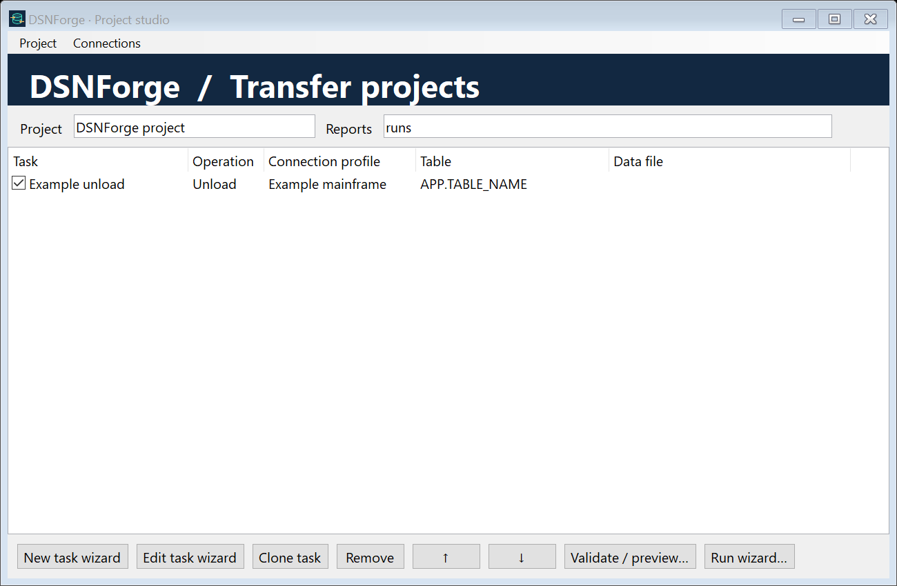

> نسخهٔ ۱٫۲: [راهنمای فارسی ویزاردها، پروفایل اتصال، dbmeta و ZIP](docs/WIZARDS.fa.md)

<p align="center"></p>

[English](README.md) · **فارسی** · [راهنمای کامل فارسی](docs/USER-GUIDE.fa.md) · [تاریخچه تغییرات](CHANGELOG.md)

# DSNForge

**ابزار ویندوزی و کتابخانهٔ دات‌نت برای انتقال داده در IBM Db2 for z/OS**

DSNForge اجرای `LOAD` و `UNLOAD` از طریق `DSNUTILU`، مدیریت Dataset و انتقال FTP را در قالب پروژه‌های قابل ذخیره ارائه می‌کند. نام برنامه DSNForge و نام مخزن GitHub آن **DBForge** است.

## خروجی‌های مستقل

| خروجی | کاربرد |
|---|---|
| **GUI** | ساخت پروژه، ویرایش تنظیمات، اعتبارسنجی و مشاهده گزارش‌ها |
| **Library** | استفاده از موتور انتقال در برنامه‌های ‎.NET Framework 4.8‎ |
| **CLI** | اجرای پروژه در اسکریپت و خط فرمان |
| **Installer** | نصب برای کاربر جاری، میانبر و حذف نصب |

فایل‌ها در بخش [Releases](https://github.com/ParhamDRP1/DBForge/releases) منتشر می‌شوند. GUI، CLI و Library بسته‌های جدا دارند؛ بسته NuGet نیز به Release پیوست می‌شود.

## قابلیت‌ها

- LOAD از CSV متنی، فایل native، Dataset موجود یا کارت تولیدشده توسط UNLOAD.
- UNLOAD از جدول و دریافت فایل داده و کارت‌های SYSPUNCH.
- انتقال ترکیبی روی یک سرور: داده روی مین‌فریم می‌ماند و از FTP به کلاینت رفت‌وبرگشت نمی‌کند.
- پروژه‌های چندجدولی قابل ذخیره و بازیابی با JSON؛ رمزها جدا از پروژه نگه داشته می‌شوند.
- تعیین batch در LOAD، ساخت Dataset، تنظیم RECFM/LRECL/BLKSIZE و حذف اختیاری پس از موفقیت.
- حالت‌های Binary/ASCII/EBCDIC، FTP فعال و غیرفعال، TLS صریح و گزینه‌های SITE.
- اعتبارسنجی محلی و PREVIEW روی DB2، ویرایش متن کامل دستورهای تخصصی Utility.
- لاگ زمان‌دار، پیشرفت انتقال فایل، سرعت و ETA آپلود، heartbeat و گزارش JSON/CSV/HTML.



## شروع سریع

۱. Installer را نصب یا ZIP برنامهٔ GUI را باز کنید.

۲. `DSNForge.Desktop.exe` را اجرا و مشخصات محیط خود را در Connections وارد کنید.

۳. مرحله‌های LOAD، UNLOAD یا TRANSFER را اضافه کنید. جدول مقصد باید از قبل وجود داشته باشد.

۴. برای CSV متنی، ساختار ستون‌ها را تعریف یا با Read table layout از DB2 بخوانید.

۵. Validate، سپس DB2 Preview و در پایان Run project را اجرا کنید.

تمام آدرس‌ها و نام‌های نمونه جایگزین‌پذیرند؛ اطلاعات محیط واقعی در مخزن عمومی قرار ندارد.

## پیش‌نیازها و محدودیت‌ها

Windows x64 و ‎.NET Framework 4.8‎ لازم است. اتصال واقعی DB2 به درایور نصب‌شدهٔ Microsoft Host Integration Server، سرویس DSNUTILU و مجوزهای لازم نیاز دارد. درایور اختصاصی در بسته توزیع نمی‌شود؛ بیلد و آزمون‌های آفلاین بدون آن انجام می‌شوند.

CSV خودکار برای ستون‌های CHAR/VARCHAR است. انواع native و nullable به کارت مناسب نیاز دارند. اجرای مراحل ترتیبی است و هر پروژه یک پروفایل اتصال دارد. SFTP پیاده نشده است. حالت Active FTP، TLS و EBCDIC در محیط توسعه آزمایش زنده نشده‌اند.

درصد پیشرفت فایل نمایش داده می‌شود؛ DSNUTILU از این رابط شمار ردیف زنده نمی‌دهد. توقف کلاینت به معنی rollback سرور نیست. نتیجهٔ نامشخص Utility با شناسه ثبت می‌شود و خودکار تکرار نمی‌شود. بازیابی پروژه به معنای ادامهٔ خودکار اجرای نیمه‌تمام نیست.

## بیلد و تاریخچه

```powershell
git clone https://github.com/ParhamDRP1/DBForge.git
cd DBForge
.\build.ps1
.\scripts\package.ps1 -InstallCompiler
```

نسخهٔ 1.1 شامل مستندات دوزبانه، لوگو و آیکون، بسته‌های مستقل، Installer و workflow بیلد GitHub است. جزئیات در [تاریخچه](CHANGELOG.md) و [یادداشت انتشار](docs/releases/1.1.md) آمده است. فایل‌های اجرایی فعلاً امضای دیجیتال ناشر ندارند.

آزمایش عملی شامل انتقال ۱۰هزار ردیف و مقایسهٔ دقیق ۲۱ فیلد، از جمله فارسی، بوده است؛ این آزمون تضمین سرعت یا سازگاری همهٔ میزبان‌ها نیست.

## منابع و مجوز

منابع رسمی IBM و Microsoft در [README انگلیسی](README.md#references) فهرست شده‌اند. این پروژه مستقل است و وابستگی سازمانی به IBM یا Microsoft ندارد.

ناشر: [ParhamDRP1](https://github.com/ParhamDRP1) · [مجوز MIT](LICENSE)
