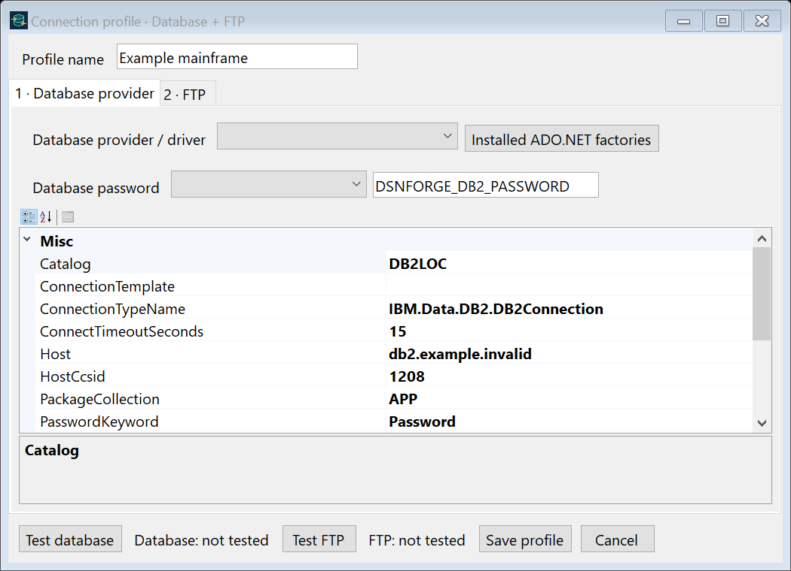
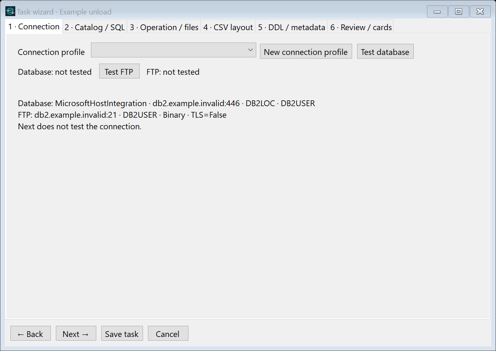
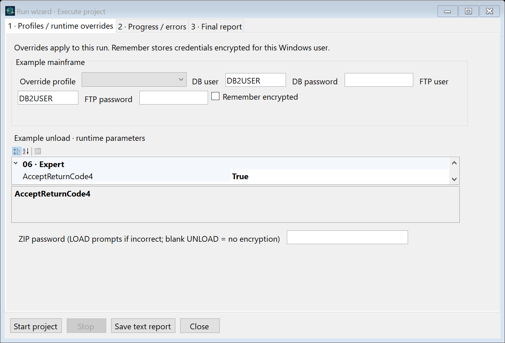

# Task and execution wizards (1.2)

[راهنمای فارسی](WIZARDS.fa.md)

## Connection profiles

Open **Connections → Manage connection profiles**. A profile holds both Database and FTP
settings. Create, edit or clone a profile under a new name. Saved profiles live in
`%LOCALAPPDATA%\DSNForge\profiles.json`; projects also carry their selected profile definitions.
Every task selects one profile from a dropdown. The task wizard can open a modal new-profile
editor and selects the created profile when it returns.

Database provider choices are Microsoft Host Integration Server, OLE DB, ODBC, a registered
ADO.NET factory, or a custom installed assembly/connection class. Drivers must be installed
for x64. For non-Microsoft providers fill `ConnectionTemplate` using `{host}`, `{port}`,
`{catalog}` and `{user}` placeholders; set `PasswordKeyword` (e.g. `PWD` for ODBC).
Passwords are injected through the connection-string builder. Password fields in the
stored template are rejected. Selecting a driver does not install it or prove DSNUTILU
compatibility; test the installed driver against your host. Only the Microsoft provider
has been integration-tested here.

Database and FTP passwords independently support:

- `Password_Environment_Variable`: resolve the named variable when running.
- `Manual`: enter now; save only Windows DPAPI CurrentUser ciphertext.
- `RuntimePrompt`: do not save a password; ask the operator at execution.

DPAPI secrets can be opened by the Windows account that encrypted them. Moving a project
to another account/machine requires re-entering Manual secrets or choosing environment/
runtime credentials. **Remember encrypted** stores the execution profile, usernames and
passwords in an encrypted local file. Cleartext secrets are not written to project JSON.

**Test database** and **Test FTP** are independent manual buttons. Their checkmarks indicate
that the connection opened successfully, not that every utility privilege exists. A failed
test does not prevent saving: the editor asks whether to save anyway. **Next** never runs
connection tests. Catalog/layout retrieval is a separate read operation.

## Define a task

Use **New task wizard** or double-click a task:

1. **Connection**: select a saved profile, create one, or manually test either connection.
2. **Catalog / SQL**: name the task and choose LOAD, UNLOAD or TRANSFER. Read the catalog;
   the table controls also accept a new target name. For UNLOAD enter an optional single
   read-only SELECT. SELECT export runs through the database reader, not DSNUTILU; no
   arbitrary SQL-to-utility-card conversion is attempted.
3. **Operation / files**: choose data/ZIP and optional `.dbmeta`; set batch size, native
   record handling, dataset allocation, disposition, output compression and advanced
   utility switches. The ZIP password editor has the same three secret modes.
4. **CSV layout**: read the target/source table or query columns, or import metadata.
   Columns are included by default. Edit Included, SQL type, byte capacity, code page
   (`0` inherits `LocalCodePage`) and Trim. None preserves whitespace. Layout can also be
   entered manually when the catalog is unavailable.
5. **DDL / metadata**: review/edit CREATE TABLESPACE and CREATE TABLE statements. Enable
   **Create target table if missing** only when desired. The target name in CREATE TABLE
   must match the task target. Existing tablespaces are detected and skipped.
6. **Review / cards**: inspect the query or utility statements, then save the task.

The main screen keeps only the task list and project settings. Tasks run in list order;
connections are managed separately. Format-1 projects still load; newly saved projects
use format 2 so older executables cannot silently ignore profile settings.

## CSV versus native UNLOAD

In the profile-aware runner, **Delimited** uses a streaming SELECT reader and emits actual
CSV, including record terminators and optional header. A custom SELECT uses this route too.
**Native** uses DSNUTILU and FTP; its generated LOAD cards preserve the utility record layout.
Native records cannot accept CSV field transformations. Choose Delimited for column
selection, per-column encoding or Trim. Native LOAD still requires correct RECFM/LRECL,
RDW and host FTP options; metadata carries the explicitly configured native settings.

Mixed field encodings must be ASCII-compatible so quotes, separators and newlines have
consistent bytes. Uniform UTF-16 files can use a single file encoding. Unsupported characters
cause an error instead of replacement. Query CSV uses `\N` for NULL and escapes literal
backslashes; `.dbmeta` records the NULL policy. Empty strings remain distinct from NULL.
Packed LOAD supports text and external numeric/date/time types; LOB, XML, binary and unusual
native types require appropriate native cards. Numeric/date packing is unit-tested, but
its host-side type conversions have not all been integration-tested.

## Metadata and cards

Every successful profile-aware UNLOAD creates `data.csv.dbmeta` (or `data.bin.dbmeta`).
The JSON includes output columns, SQL types, encoding, NULL/header/delimiter settings,
source/query, editable creation SQL, source catalog table/column/tablespace attributes,
and utility cards when DSNUTILU supplied them. Native LOAD cards are also saved as `.load.txt`.
Cards are important: they describe positions, types, NULL indicators and utility options.
On LOAD the target table and input DD are rebound rather than executing the source target.

Generated DDL is an editable reconstruction, not a complete schema backup. It includes
basic columns/defaults and tablespace settings; review identity/generated expressions,
partition bounds, storage policy, keys/indexes, LOB/XML auxiliary objects and grants.
Original catalog attributes are retained for that review. The database must already exist.
A query result can differ from its source table: its output columns define its target DDL.
No CREATE statement runs while editing or during PREVIEW. Creation is opt-in at execution.

## Run a project

**Run wizard** opens a modal window. The first page allows profile overrides, usernames,
passwords, Remember, per-task parameters and ZIP passwords. The next page shows timestamped
progress/errors with five-second heartbeats. Byte percentage/ETA is shown when known;
DSNUTILU does not provide continuous server row counts. Stop requests cancellation; an
interrupted server utility must be checked by its UtilityId before resubmission.

ZIP is detected by its signature. Protected ZIPs ask again at run time if the password is
missing/wrong. Archives contain exactly one data file plus optional metadata/cards; paths
cannot escape the extraction directory. Extraction is validated before any LOAD/DDL starts.
Output compression creates a separate `.zip` containing data and sidecars; original files
are retained. Non-empty passwords use AES-256 ZIP. Temporary extraction files are deleted
when the task ends. A ZIP password does not encrypt retained original CSV/metadata files.

The last page shows operation totals, confirmed inserted/exported rows, rejected rows
when reported, failures, elapsed time, rows/second and rows/minute. Unknown utility counts
are marked unknown. **Save text report** includes the event/error list; JSON/CSV/HTML,
`summary.txt` and `events.jsonl` are also saved in the run directory.

## Library and CLI

Use `ProjectRunner` for profiles, metadata, SELECT export and ZIP. `TransferEngine` remains
the lower-level utility/dataset engine for compatible integrations.

```csharp
var project = ProjectStore.Load("project.json");
var options = new RunOptions();
// Supply per-profile runtime credentials when necessary:
options.Credentials[profileId] = credentials;
options.RequestArchivePassword = message => GetPasswordFromOperator(message);
var runner = new ProjectRunner();
runner.Progress += OnProgress; // worker thread: marshal to your UI
var result = await runner.RunAsync(project, options, preview: false, cancellationToken);
```

CLI `run` and `preview` detect profiled projects. Runtime secrets use masked input; redirected
input requires environment-variable credentials. Do not automate password prompts.

## References

- [IBM DSNUTILU](https://www.ibm.com/docs/en/db2-for-zos/12.0.0?topic=db2-dsnutilu)
- [IBM SYSIBM.SYSCOLUMNS](https://www.ibm.com/docs/en/db2-for-zos/12.0.0?topic=tables-syscolumns)
- [IBM SYSIBM.SYSTABLESPACE](https://www.ibm.com/docs/en/db2-for-zos/12.0.0?topic=tables-systablespace)
- [IBM LOAD syntax and NULLIF](https://www.ibm.com/docs/en/db2-for-zos/13.0.0?topic=load-syntax-options-control-statement)
- [SharpZipLib ZIP API](https://icsharpcode.github.io/SharpZipLib/api/ICSharpCode.SharpZipLib.Zip.ZipOutputStream.html)







Metadata precedence: first-time LOAD imports layout, encoding, header and NULL settings together, even if the catalog was read first. After importing/reviewing metadata in the wizard, edited settings are retained. Set UseMetadataLayout=false for fully manual input settings.
